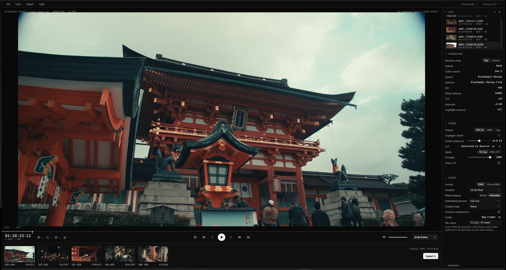
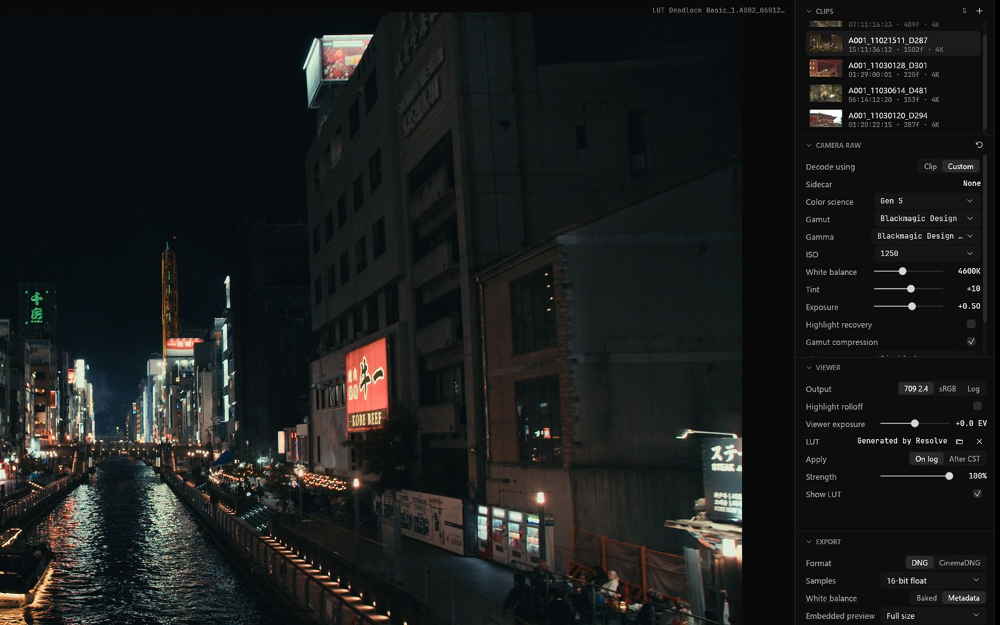
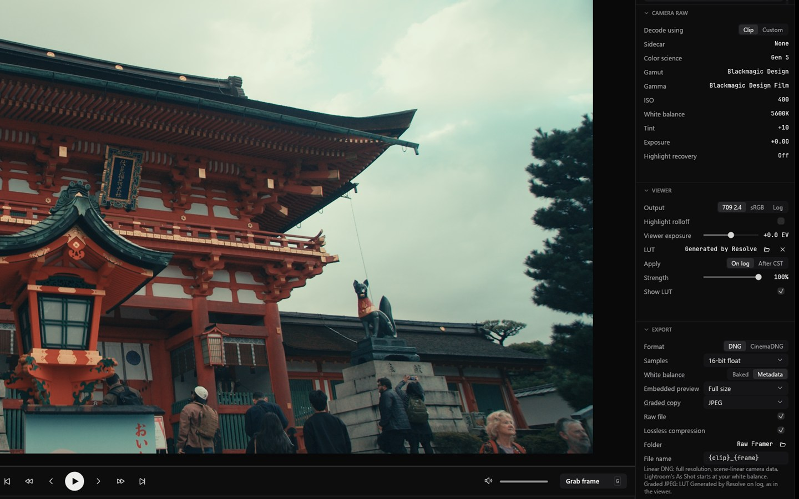
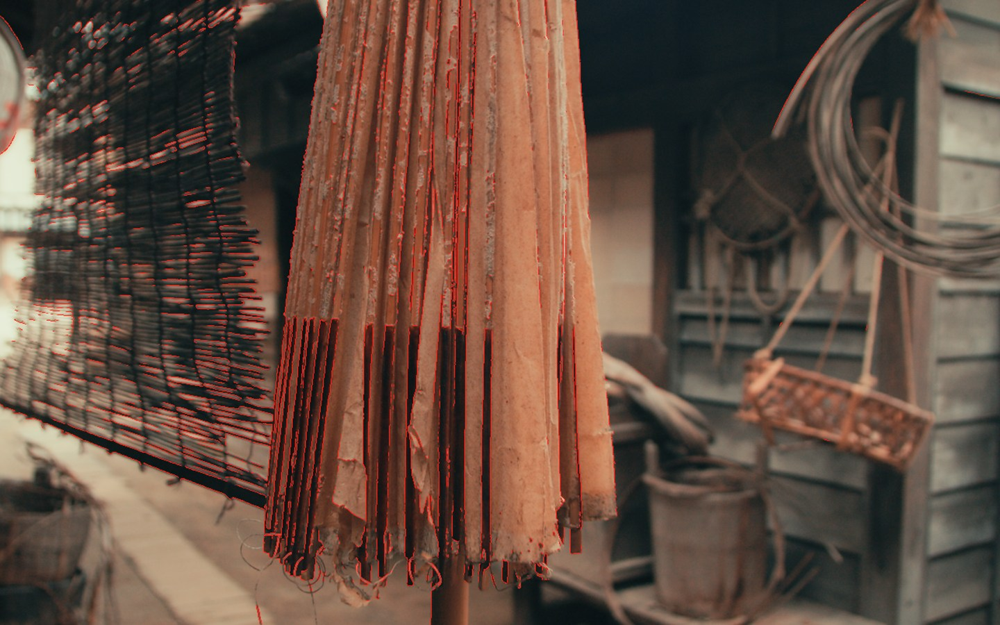
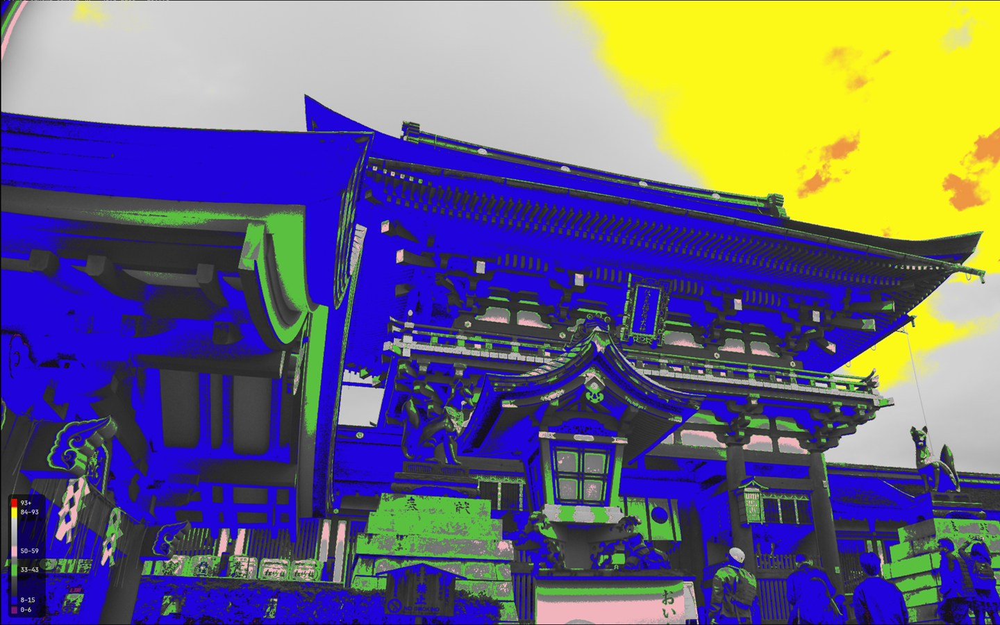

<div align="center">

# Raw Framer

**Pull perfect stills from Blackmagic RAW footage.**

Preview `.braw` clips with the same decode and color transform DaVinci Resolve uses, find the
frame you want, and export it as a full-resolution **Linear DNG** you can edit like a raw photo
in Lightroom or Photoshop.

[](../../releases/latest)
[](https://buymeacoffee.com/wtfzgeo)


<br>



</div>

<br>

## Why Raw Framer

A frame grab from a video timeline is an 8-bit, display-referred picture. Raw Framer gives you
the **whole decoded frame**: full sensor resolution, scene-linear, 16- or 32-bit float, with
the camera's color science intact. Open it in Lightroom and the exposure, highlight and white
balance sliders behave the way they do on a camera raw file.

<table>
  <tr>
    <td width="50%" valign="top">
      
      <h3>Camera RAW, the Resolve way</h3>
      ISO, white balance, tint, exposure, highlight recovery, color science, gamut and gamma,
      decoded by the Blackmagic RAW SDK. Type exact values or drag with fine control, then
      <b>save to the clip's sidecar</b> so Resolve and Blackmagic RAW Player see the same
      corrections.
    </td>
    <td width="50%" valign="top">
      
      <h3>Raw and graded exports</h3>
      Linear DNG or CinemaDNG at 16-bit float, 32-bit float or 16-bit integer, with lossless
      compression. White balance can be baked in or written as As&nbsp;Shot metadata. Add a
      <b>graded JPEG or 16-bit TIFF</b> with your LUT applied, exactly as the viewer shows it.
    </td>
  </tr>
  <tr>
    <td width="50%" valign="top">
      
      <h3>Focus peaking</h3>
      Thin colored lines on in-focus edges, modeled on Blackmagic cameras' colored lines. Edges
      are measured at native resolution, so they stay accurate when you zoom in.
    </td>
    <td width="50%" valign="top">
      
      <h3>False color, histogram and guides</h3>
      Blackmagic's false color scale, measured on the picture or on camera log, plus a live
      histogram and composition guides for checking a frame before you export it.
    </td>
  </tr>
</table>

### Also included

- **Resolve-accurate viewer.** A color space transform to Rec.709 Gamma 2.4 or sRGB, plus your
  own `.cube` LUT, applied on log or after the transform.
- **Playback.** J/K/L shuttle, frame stepping, scrubbing and clip audio, with a frame cache
  sized to your machine.
- **Lightbox tray.** Press <kbd>G</kbd> to grab frames from any open clip, then export them all
  at once. Each frame follows its clip's corrections or keeps its own.
- **GPU decode.** Optional CUDA (NVIDIA) or OpenCL decoding, chosen from the top bar.
- **Picks up where you left off.** Clips, grabbed frames and settings are saved continuously
  and restored after a restart or a crash.

<br>

## Download

1. Download `raw-framer-<version>-windows-x64.zip` from the
   **[latest release](../../releases/latest)**.
2. Unzip it anywhere and run `raw-framer.exe`.

Nothing to install: the Blackmagic RAW runtime ships in the `BlackmagicRawAPI` folder next to
the app. Requires Windows 10 or 11, 64-bit.

## Quick start

1. Drop `.braw` clips onto the window, or press <kbd>Ctrl</kbd>+<kbd>O</kbd>.
2. Find your frame with <kbd>Space</kbd>, <kbd>J</kbd> <kbd>K</kbd> <kbd>L</kbd> and the
   arrow keys.
3. Adjust it in **Camera RAW** (set *Decode using* to **Custom**).
4. Press <kbd>G</kbd> to grab it, then <kbd>Ctrl</kbd>+<kbd>E</kbd> to export.

Exports go to `Pictures\Raw Framer` unless you choose another folder in the Export panel.

<details>
<summary><b>Keyboard shortcuts</b></summary>

<br>

| Key | Action |
|-----|--------|
| <kbd>Space</kbd> / <kbd>K</kbd> | Play-pause / pause |
| <kbd>J</kbd> / <kbd>L</kbd> | Reverse / forward; press again for 2× 4× 8× |
| <kbd>←</kbd> <kbd>→</kbd> (<kbd>Shift</kbd>: ×10) | Step frames |
| <kbd>Home</kbd> / <kbd>End</kbd> | First / last frame |
| <kbd>G</kbd> | Grab the current frame to the tray |
| <kbd>Ctrl</kbd>+<kbd>E</kbd> | Export all grabbed frames |
| <kbd>Ctrl</kbd>+<kbd>Shift</kbd>+<kbd>E</kbd> | Grab and export the current frame |
| <kbd>F</kbd> / double-click | Fit / actual pixels; scroll to zoom, drag to pan |
| <kbd>Ctrl</kbd>+<kbd>O</kbd> | Open clips |
| <kbd>Alt</kbd>+<kbd>G</kbd> / <kbd>P</kbd> / <kbd>C</kbd> / <kbd>H</kbd> | Guides / focus peaking / false color / histogram |
| <kbd>Alt</kbd>+<kbd>0</kbd> | All assists off |
| <kbd>M</kbd> | Mute / unmute |

</details>

<details>
<summary><b>Working with the DNG in Lightroom</b></summary>

<br>

- **White balance: Baked** (default) puts your white balance in the pixels, exactly as the
  viewer shows it.
- **White balance: Metadata** stores it as the DNG's As Shot value instead, so Lightroom's
  Temp and Tint sliders start from your setting.
- The DNG opens with the camera's look as the baseline. Exposure, highlights and the other
  sliders work on the linear data.
- Your LUT is never baked into the DNG. Use a **graded copy** when you need the look applied.

**About "raw":** Blackmagic RAW is partly demosaiced in camera, and the SDK never exposes the
sensor's Bayer mosaic, so no tool can make a Bayer DNG from BRAW. Raw Framer writes a Linear
DNG: the full decoded detail and dynamic range in floating point, far more than an 8- or 16-bit
frame grab.

</details>

<details>
<summary><b>Panels and layout</b></summary>

<br>

The right-hand column is a dock. Click a panel's header to collapse it, and drag the line
between two open panels to resize them. Each panel scrolls on its own and the layout is
remembered. The mouse wheel scrolls the frame tray sideways, and new grabs scroll into view.

</details>

<br>

## Support the project

Raw Framer is built and maintained by one person. If it saves you time on a shoot or in post,
a coffee keeps it going.

<a href="https://buymeacoffee.com/wtfzgeo"></a>

Bug reports and feature ideas are welcome in [Issues](../../issues).

<br>

## Building from source

<details>
<summary><b>Requirements, build, tests and packaging</b></summary>

<br>

**Requirements (Windows)**

- Rust **1.95+** (`rustup update stable`)
- Visual Studio Build Tools (MSVC and the Windows 10/11 SDK, which provides `midl.exe`)
- **Blackmagic RAW SDK**, installed to its default path or pointed to with `BRAW_SDK_DIR`.
  Download it from blackmagicdesign.com/support under "Blackmagic RAW".
- At run time, a Blackmagic RAW runtime: the SDK's `Win\Libraries`, Blackmagic RAW Player or
  DaVinci Resolve. Override the location with `BRAW_RUNTIME_DIR`.

**Build and run**

```powershell
cargo build --release
.\target\release\raw-framer.exe                        # empty app: drop clips onto the window
.\target\release\raw-framer.exe "D:\clips\A001_C001.braw"
.\target\release\raw-framer.exe --lut "C:\path\look.cube" clip.braw
```

Without the SDK the app still builds and runs with a synthetic test pattern
(File → Open test pattern).

**Command-line probe**

```powershell
.\target\release\rf-braw-probe.exe clip.braw 120                 # clip info, gamma lists, decode timing
.\target\release\rf-braw-probe.exe clip.braw 120 --dng out.dng   # export frame 120 (f16, deflate)
#   options:     --f32  --u16  --cdng  --raw (uncompressed)
#   graded copy: --jpg | --tif  [--lut look.cube]  [--graded-only]
#   decoder:     --pipelines (list)  --pipeline cpu|cuda|opencl
```

**Tests**

```powershell
cargo test --workspace
```

**Release zip**

```powershell
.\scripts\package.ps1      # dist\raw-framer-<version>-windows-x64.zip + .sha256
```

The script builds the workspace, bundles the Blackmagic RAW runtime from the installed SDK and
generates the third-party notices with cargo-about
(`cargo install --locked cargo-about --features cli`). It uploads nothing; it prints the
`gh release create` command to run. Releases are built locally because CI can't download the
Blackmagic RAW SDK.

</details>

## License

Copyright © 2026 George Gal.

- **Source code:** [PolyForm Strict License 1.0.0](LICENSE). You may read it and use it for
  noncommercial purposes, but not modify or redistribute it.
- **Official releases:** under an [additional permission](USE-PERMISSION.md), they may be used
  for any purpose, **including commercial photography, filmmaking and post-production**. Your
  images and exported files are yours. Modifying, redistributing or reselling the software is
  not allowed.

Contributions: please open an issue first. Pull requests can only be accepted under a
contributor agreement, so the project can keep offering other licenses.

<details>
<summary><b>Third-party software</b></summary>

<br>

- **Blackmagic RAW SDK** (Blackmagic Design license). Headers are generated at build time and
  not vendored. The release zip includes the Blackmagic RAW runtime libraries, as the SDK
  license allows.
- **Fonts** in `app/assets/fonts`: JetBrains Mono and Barlow Condensed (OFL) and Phosphor icons
  (MIT). Their licenses are alongside. Segoe UI is loaded from Windows at run time.
- **Open-source Rust libraries**, mostly MIT or Apache-2.0. Their licenses are listed in
  `licenses\THIRD_PARTY_LICENSES.md` in the release zip.
- This software is based in part on the work of the Independent JPEG Group (via
  `jpeg-encoder`).

Blackmagic RAW, DaVinci Resolve, Lightroom and Photoshop are trademarks of their respective
owners. Raw Framer is not affiliated with or endorsed by Blackmagic Design or Adobe.

</details>
